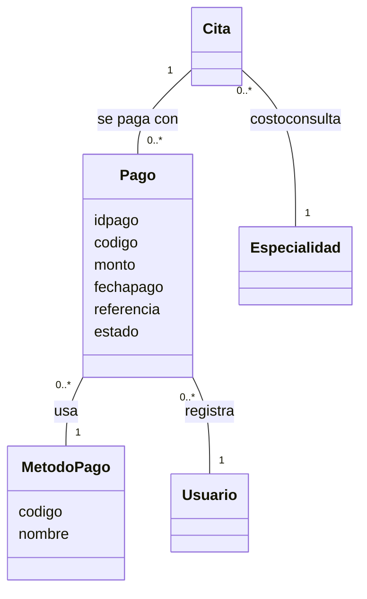

# Preguntas del examen · Guía para presentar

Guía del Grupo 20 del proyecto [Nova Salud](https://github.com/Kato-001/nova-salud) para responder las seis preguntas mostrando el archivo exacto en el documento y en el software.

- **Informe:** [informe/Informe_NovaSalud_Grupo20.pdf](https://github.com/Kato-001/nova-salud/blob/main/Docs/informe/Informe_NovaSalud_Grupo20.pdf) (las páginas citadas son las del PDF).
- **Sistema:** https://nova-salud-clinica.vercel.app
- **Cuentas de prueba:** `admin` (administrador), `mrojas` (recepcionista), `rsuarez` (médico), `jperez` (paciente). La contraseña está en [Guion_Presentacion.html](https://github.com/Kato-001/nova-salud/blob/main/Docs/Guion_Presentacion.html).
- **Rutas del sistema:** todas se declaran en [api/index.php](https://github.com/Kato-001/nova-salud/blob/main/api/index.php#L72-L80).

| # | Pregunta | Caso de uso | Estado |
|---|---|---|---|
| 1 | Secuencia de pasos para registrar una cita | CU10 Reservar ficha | Implementado |
| 2 | Caso de uso para modificar la reprogramación | CU11 Reprogramar cita | Implementado |
| 3 | Cómo se identifican los estados de las citas | CU13 y diagrama de estados | Implementado |
| 4 | Mensajes en la cancelación de una cita | CU12 Cancelar cita | Implementado |
| 5 | Nueva funcionalidad: registrar pagos | CU21 (propuesto) | **No implementado: es una propuesta** |
| 6 | Formatos de los reportes y comando de voz | CU20 Generar reportes | Pantalla, CSV y PDF implementados; **voz no implementada** |

---

## 1. Secuencia de pasos para registrar una cita médica

**Respuesta corta:** es el **CU10 Reservar ficha**. La recepcionista elige paciente, especialidad, médico, fecha y una hora libre; el servidor valida, bloquea al médico, vuelve a comprobar la disponibilidad y guarda la cita con su historial y su recordatorio, todo en una transacción.

### En el documento

| Qué mostrar | Página del informe | Archivo |
|---|---|---|
| Descripción del caso de uso CU10 | 39 | [CU10 Reservar ficha.png](<diagramas/2 Casos de Uso/Casos de Uso 2 (Ciclo II)/CU10 Reservar ficha.png>) |
| Prototipo de la interfaz | 74 | [CU10 Reservar ficha.png](<diagramas/2 Casos de Uso/Prototipos/CU10 Reservar ficha.png>) |
| Diagrama de comunicación | 126 | [CU10 Reservar ficha.png](<diagramas/3 Análisis/3 Comunicación/Ciclo II/CU10 Reservar ficha.png>) |
| Diagrama de clases de análisis | 143 | [CU10 Reservar ficha.png](<diagramas/3 Análisis/2 Clases de análisis/Ciclo II/CU10 Reservar ficha.png>) |
| **Diagrama de secuencia** | **173** | [CU10 Reservar ficha.png](<diagramas/4 Diseño/3 Secuencia/Ciclo II/CU10 Reservar ficha.png>) |
| Pruebas P19, P20 y P21 | 243–244 | [pruebas/pruebas_caja_negra.py](https://github.com/Kato-001/nova-salud/blob/main/Docs/pruebas/pruebas_caja_negra.py#L167) |


### Los pasos (según el diagrama de secuencia)

1. La recepcionista elige paciente, especialidad, médico, fecha y una hora libre.
2. La pantalla envía `POST /citas/guardar`.
3. `CitaController` llama a `CitaService::programar(datos)`.
4. El servicio valida los datos con `Validator` (ids, fecha no pasada, hora).
5. Abre la transacción (`BEGIN`).
6. Bloquea al médico con `SELECT … FOR UPDATE`.
7. Comprueba que el paciente esté activo y que el médico atienda esa especialidad.
8. Pregunta a `Disponibilidad::estaLibre(médico, fecha, hora)`.
9. Si está ocupado o fuera de horario: `ROLLBACK` y vuelve al formulario con el mensaje.
10. Si está libre: `INSERT cita` (aquí actúan el trigger `validar_cita` y la restricción `EXCLUDE`).
11. `INSERT historialcita` con la acción PROGRAMAR.
12. `INSERT notificacion` (aviso y recordatorio).
13. `COMMIT`.
14. `INSERT bitacora` y mensaje «Cita CM-#### programada».

### En el software

1. Ingresar como `mrojas` y abrir **Citas → Programar cita** (`/citas/nueva`).
2. Buscar al paciente, elegir especialidad, médico y fecha: solo aparecen los horarios libres.
3. Confirmar: se abre el detalle de la cita en estado **Programada**.
4. Para mostrar la validación, intentar la misma hora con otro paciente: lo rechaza.

Capturas de respaldo: [41_cita_buscar_paciente.png](<capturas/41_cita_buscar_paciente.png>), [42_cita_programar.png](<capturas/42_cita_programar.png>), [43_cita_detalle.png](<capturas/43_cita_detalle.png>).

### En el código

| Capa | Archivo |
|---|---|
| Ruta | [api/index.php](https://github.com/Kato-001/nova-salud/blob/main/api/index.php#L74-L75) |
| Pantalla | [Frontend/views/P4_GestionCitas/citas/nueva.php](https://github.com/Kato-001/nova-salud/blob/main/Frontend/views/P4_GestionCitas/citas/nueva.php) y [Frontend/public/assets/js/citas.js](https://github.com/Kato-001/nova-salud/blob/main/Frontend/public/assets/js/citas.js) |
| Controlador | [Bakend/app/controllers/CitaController.php](https://github.com/Kato-001/nova-salud/blob/main/Bakend/app/controllers/CitaController.php#L45) · `guardar()` |
| Lógica de negocio | [Bakend/app/services/CitaService.php](https://github.com/Kato-001/nova-salud/blob/main/Bakend/app/services/CitaService.php#L37) · `programar()` |
| Disponibilidad | [Bakend/app/services/Disponibilidad.php](https://github.com/Kato-001/nova-salud/blob/main/Bakend/app/services/Disponibilidad.php#L85) · `estaLibre()` |
| Tabla y restricción `EXCLUDE` | [Bakend/database/01_esquema.sql](https://github.com/Kato-001/nova-salud/blob/main/Bakend/database/01_esquema.sql#L217-L240) |
| Trigger `validar_cita` | [Bakend/database/02_reglas_negocio.sql](https://github.com/Kato-001/nova-salud/blob/main/Bakend/database/02_reglas_negocio.sql#L21) |

---

## 2. ¿Tienen un caso de uso para modificar la reprogramación?

**Respuesta corta:** sí, el **CU11 Reprogramar cita**. Cambia la fecha y la hora de una cita programada o confirmada, exige un motivo y guarda la fecha anterior y la nueva en `HistorialCita`. Para modificar una reprogramación ya hecha se ejecuta de nuevo el CU11: la cita vuelve a quedar en estado Programada y cada cambio queda en el historial.

### En el documento

| Qué mostrar | Página del informe | Archivo |
|---|---|---|
| Caso de uso y descripción | 40 | [CU11 Reprogramar cita.png](<diagramas/2 Casos de Uso/Casos de Uso 2 (Ciclo II)/CU11 Reprogramar cita.png>) |
| **Diagrama de comunicación** | **127** | [CU11 Reprogramar cita.png](<diagramas/3 Análisis/3 Comunicación/Ciclo II/CU11 Reprogramar cita.png>) |
| **Diagrama de clases de análisis** | **144** | [CU11 Reprogramar cita.png](<diagramas/3 Análisis/2 Clases de análisis/Ciclo II/CU11 Reprogramar cita.png>) |
| Diagrama de secuencia | 174 | [CU11 Reprogramar cita.png](<diagramas/4 Diseño/3 Secuencia/Ciclo II/CU11 Reprogramar cita.png>) |
| Prueba P22 | 245 | [pruebas/pruebas_caja_negra.py](https://github.com/Kato-001/nova-salud/blob/main/Docs/pruebas/pruebas_caja_negra.py#L192) |


### Cómo explicar el diagrama de comunicación

1. La recepcionista elige la nueva fecha y hora y escribe el motivo.
2. `IU_Reprogramar` envía `reprogramar(cita, fecha, hora, motivo)` a `CtrlCita`.
3. `CtrlCita` obtiene la cita y la bloquea (`FOR UPDATE`).
4. Pregunta a `CtrlDisponibilidad` si el nuevo horario está libre, excluyendo la propia cita.
5. Actualiza la fecha y la hora de la `Cita` (mensaje 6 del diagrama).
6. Registra el cambio en `HistorialCita`: fecha anterior → fecha nueva (mensaje 7).
7. Reemplaza el recordatorio en `Notificacion` (mensaje 8).

> **Ojo:** en la imagen los mensajes están numerados 1, 2, 3, 4, 6, 7, 8. Falta el número 5: es un error de numeración, no un paso que falte.

### Cómo explicar el diagrama de clases

| Clase | Estereotipo | Qué aporta |
|---|---|---|
| `IU_Reprogramar` | «form» (interfaz) | Atributos `idCita`, `nuevaFecha`, `nuevaHora`, `motivo` |
| `CtrlCita` | «control» | Método `reprogramar(cita, fecha, hora, motivo)` |
| `CtrlDisponibilidad` | «control» | Método `estaLibre()`; `CtrlCita` depende de él |
| `Cita` | «entity» | Métodos `obtener()` y `actualizar(fecha, hora)` |
| `HistorialCita` | «entity» | Guarda `fechaanterior`, `horaanterior`, `fechanueva`, `horanueva`, `motivo` |
| `Notificacion` | «entity» | Método `reemplazarRecordatorio()` |

Los métodos de las clases son los mismos mensajes del diagrama de comunicación.

### En el software

1. Abrir una cita programada (`/citas/ver`) y pulsar **Reprogramar**.
2. Elegir otra fecha u hora libre y escribir el motivo.
3. En el detalle, el **historial** muestra la fecha anterior y la nueva.
4. Volver a reprogramar la misma cita para demostrar que se puede modificar otra vez.

Captura de respaldo: [44_cita_reprogramar.png](<capturas/44_cita_reprogramar.png>).

### En el código

| Capa | Archivo |
|---|---|
| Rutas | [api/index.php](https://github.com/Kato-001/nova-salud/blob/main/api/index.php#L77-L78) |
| Pantalla | [Frontend/views/P4_GestionCitas/citas/reprogramar.php](https://github.com/Kato-001/nova-salud/blob/main/Frontend/views/P4_GestionCitas/citas/reprogramar.php) |
| Controlador | [Bakend/app/controllers/CitaController.php](https://github.com/Kato-001/nova-salud/blob/main/Bakend/app/controllers/CitaController.php#L75-L96) · `reprogramar()` y `guardarReprogramacion()` |
| Lógica de negocio | [Bakend/app/services/CitaService.php](https://github.com/Kato-001/nova-salud/blob/main/Bakend/app/services/CitaService.php#L90) · `reprogramar()` |

---

## 3. ¿Cómo identifican los estados de las citas?

**Respuesta corta:** una cita tiene cinco estados: **Programada, Confirmada, Atendida, Cancelada e Inasistencia**. En el documento se identifican con el diagrama de estados; en el software, con la tabla `estadocita`, la columna `cita.codigoestado` y una etiqueta de color en cada pantalla.

### En el documento

| Qué mostrar | Página del informe | Archivo |
|---|---|---|
| **Diagrama de estados de la cita** | **155** | [Diagrama de estados de la cita.png](<diagramas/3 Análisis/Diagrama de estados de la cita.png>) |
| CU13 Registrar asistencia (descripción) | 42 | [diagramas/2 Casos de Uso/Casos de Uso 2 (Ciclo II)/](https://github.com/Kato-001/nova-salud/tree/main/Docs/diagramas/2%20Casos%20de%20Uso/Casos%20de%20Uso%202%20%28Ciclo%20II%29) |
| Prueba P23 (asistencia de una cita futura) | 245 | [pruebas/pruebas_caja_negra.py](https://github.com/Kato-001/nova-salud/blob/main/Docs/pruebas/pruebas_caja_negra.py#L200) |


### Los estados y sus transiciones

| Estado | ¿Ocupa horario? | A qué puede pasar |
|---|:-:|---|
| **Programada** (inicial) | Sí | Confirmada, Atendida, Inasistencia, Cancelada |
| **Confirmada** | Sí | Atendida, Inasistencia, Cancelada; vuelve a Programada si se reprograma |
| **Atendida** | Sí | Final |
| **Inasistencia** | Sí | Final |
| **Cancelada** | **No** | Final |

- Atendida e Inasistencia solo se registran el día de la cita o después.
- Una cita en estado final no se reprograma: se registra una cita nueva.

### En el software

1. En **Citas** (`/citas`) cada fila lleva una etiqueta de color con su estado, y hay un filtro por estado.
2. En el detalle (`/citas/ver`) solo aparecen los botones válidos para el estado actual.
3. Pulsar **Confirmar**: la etiqueta cambia a Confirmada y el cambio queda en el historial.
4. En **Reportes → Citas por estado** se ve la cantidad de citas en cada estado.

Capturas de respaldo: [40_citas.png](<capturas/40_citas.png>), [43_cita_detalle.png](<capturas/43_cita_detalle.png>), [53_cita_atendida.png](<capturas/53_cita_atendida.png>).

### En el código

El estado se controla en tres niveles:

| Nivel | Archivo |
|---|---|
| Catálogo de estados (tabla `estadocita`) | [Bakend/database/01_esquema.sql](https://github.com/Kato-001/nova-salud/blob/main/Bakend/database/01_esquema.sql#L207-L212) y [03_datos_iniciales.sql](https://github.com/Kato-001/nova-salud/blob/main/Bakend/database/03_datos_iniciales.sql#L58-L63) |
| Columna `cita.codigoestado` (por defecto `PROGRAMADA`) | [Bakend/database/01_esquema.sql](https://github.com/Kato-001/nova-salud/blob/main/Bakend/database/01_esquema.sql#L229) |
| Transiciones permitidas en PHP (`TRANSICIONES`) | [Bakend/app/services/CitaService.php](https://github.com/Kato-001/nova-salud/blob/main/Bakend/app/services/CitaService.php#L20-L23) |
| Cambio de estado (`cambiarEstado()`) | [Bakend/app/services/CitaService.php](https://github.com/Kato-001/nova-salud/blob/main/Bakend/app/services/CitaService.php#L166) |
| Botones según el estado (`accionesPermitidas()`) | [Bakend/app/services/CitaService.php](https://github.com/Kato-001/nova-salud/blob/main/Bakend/app/services/CitaService.php#L209) |
| Transiciones en la base (trigger `validar_cita`) | [Bakend/database/02_reglas_negocio.sql](https://github.com/Kato-001/nova-salud/blob/main/Bakend/database/02_reglas_negocio.sql#L77-L88) |
| Etiqueta de color (`ESTADOS_CITA` y `badge_cita()`) | [Bakend/app/core/helpers.php](https://github.com/Kato-001/nova-salud/blob/main/Bakend/app/core/helpers.php#L199-L211) |
| Historial de cambios (tabla `historialcita`) | [Bakend/app/services/CitaService.php](https://github.com/Kato-001/nova-salud/blob/main/Bakend/app/services/CitaService.php#L266) |

---

## 4. Cancelación de una cita: mensajes entre la interfaz, el controlador y la base de datos

**Respuesta corta:** es el **CU12 Cancelar cita**. La interfaz envía `POST /citas/cancelar` con el motivo; el controlador llama a `CitaService::cancelar()`; el servicio, dentro de una transacción, bloquea la cita, cambia su estado a CANCELADA, guarda el motivo en el historial y avisa al paciente. La cita no se borra y deja de ocupar el horario.

### En el documento

| Qué mostrar | Página del informe | Archivo |
|---|---|---|
| Caso de uso y descripción | 41 | [CU12 Cancelar cita.png](<diagramas/2 Casos de Uso/Casos de Uso 2 (Ciclo II)/CU12 Cancelar cita.png>) |
| **Diagrama de comunicación** | **127** | [CU12 Cancelar cita.png](<diagramas/3 Análisis/3 Comunicación/Ciclo II/CU12 Cancelar cita.png>) |
| Diagrama de clases de análisis | 145 | [CU12 Cancelar cita.png](<diagramas/3 Análisis/2 Clases de análisis/Ciclo II/CU12 Cancelar cita.png>) |
| **Diagrama de secuencia** | **175** | [CU12 Cancelar cita.png](<diagramas/4 Diseño/3 Secuencia/Ciclo II/CU12 Cancelar cita.png>) |
| Procedimiento `sp_cancelar_cita` | 216 | [Bakend/database/06_procedimientos_triggers.sql](https://github.com/Kato-001/nova-salud/blob/main/Bakend/database/06_procedimientos_triggers.sql#L45) |
| **Pruebas P24 y P25** | **246** | [pruebas/pruebas_caja_negra.py](https://github.com/Kato-001/nova-salud/blob/main/Docs/pruebas/pruebas_caja_negra.py#L205) |


### Los mensajes, uno por uno

| # | De → a | Mensaje |
|---|---|---|
| 1 | Recepcionista → Interfaz | Pulsa **Cancelar cita** y escribe el motivo en la ventana |
| 2 | Interfaz → Controlador | `POST /citas/cancelar` con `idcita`, `motivo` y el token CSRF |
| 3 | Controlador → Servicio | `CitaService::cancelar(cita, motivo)`, después de `Auth::requerir('citas.gestionar')` |
| 4 | Servicio → Base de datos | `BEGIN` y `SELECT * FROM cita … FOR UPDATE` |
| 5 | Servicio | Valida el estado: solo Programada o Confirmada; si no, error «no se puede cancelar» |
| 6 | Servicio → Base de datos | `UPDATE cita SET codigoestado = 'CANCELADA'` (el trigger `validar_cita` revisa la transición) |
| 7 | Servicio → Base de datos | `INSERT historialcita` (acción CANCELAR y el motivo) |
| 8 | Servicio → Base de datos | `DELETE` de los recordatorios pendientes e `INSERT` del aviso de cancelación |
| 9 | Servicio → Base de datos | `COMMIT` y luego `INSERT bitacora` |
| 10 | Controlador → Interfaz | Redirige al detalle con «Cita cancelada. El horario quedó libre…» |

### Las pruebas

| Prueba | Qué comprueba | Resultado esperado |
|---|---|---|
| **P24** | Cancelar una cita con motivo | Estado Cancelada; el horario queda libre y el historial se conserva |
| **P25** | Reprogramar una cita cancelada | No lo permite y vuelve al detalle |

Resultados de la última ejecución: [pruebas/resultados.json](https://github.com/Kato-001/nova-salud/blob/main/Docs/pruebas/resultados.json).

### En el software

1. Abrir una cita programada (`/citas/ver`) y pulsar **Cancelar cita**.
2. Escribir el motivo y confirmar: la etiqueta cambia a **Cancelada**.
3. Mostrar el historial con el motivo y que ya no aparecen los botones de reprogramar ni atender.
4. Volver a **Programar cita**: el horario de la cita cancelada está libre otra vez.

Capturas de respaldo: [45_cita_cancelar_motivo.png](<capturas/45_cita_cancelar_motivo.png>), [46_cita_cancelada_historial.png](<capturas/46_cita_cancelada_historial.png>).

### Cómo se refleja en el código PHP

| Paso | Archivo |
|---|---|
| Ruta `POST /citas/cancelar` | [api/index.php](https://github.com/Kato-001/nova-salud/blob/main/api/index.php#L79) |
| Formulario con el motivo | [Frontend/views/P4_GestionCitas/citas/ver.php](https://github.com/Kato-001/nova-salud/blob/main/Frontend/views/P4_GestionCitas/citas/ver.php#L79-L80) |
| Ventana que pide el motivo | [Frontend/public/assets/js/app.js](https://github.com/Kato-001/nova-salud/blob/main/Frontend/public/assets/js/app.js#L93) |
| Controlador `cancelar()` | [Bakend/app/controllers/CitaController.php](https://github.com/Kato-001/nova-salud/blob/main/Bakend/app/controllers/CitaController.php#L98-L106) |
| Servicio `cancelar()` | [Bakend/app/services/CitaService.php](https://github.com/Kato-001/nova-salud/blob/main/Bakend/app/services/CitaService.php#L135-L163) |
| Bloqueo de la fila (`FOR UPDATE`) | [Bakend/app/services/CitaService.php](https://github.com/Kato-001/nova-salud/blob/main/Bakend/app/services/CitaService.php#L235-L242) |
| Borrado de recordatorios y aviso | [Bakend/app/models/Notificacion.php](https://github.com/Kato-001/nova-salud/blob/main/Bakend/app/models/Notificacion.php#L26-L38) |
| Cancelación desde el portal del paciente | [Bakend/app/controllers/PortalController.php](https://github.com/Kato-001/nova-salud/blob/main/Bakend/app/controllers/PortalController.php#L88) |

El fragmento central de `CitaService::cancelar()`:

```php
$cita = Database::transaccion(function () use ($idcita, $motivo, $porPaciente) {
    $c = self::citaParaActualizar($idcita);                    // SELECT … FOR UPDATE
    if (!in_array($c['codigoestado'], ['PROGRAMADA', 'CONFIRMADA'], true)) {
        throw new AppException('Una cita … no se puede cancelar.');
    }
    Database::query("update cita set codigoestado = 'CANCELADA' where idcita = :id", ['id' => $idcita]);
    self::historial($idcita, 'CANCELAR', 'CANCELADA', null, null, null, null, trim($motivo));
    Notificacion::descartarRecordatorios($idcita);
    Notificacion::aviso($idcita, 'CANCELACION', "Su cita {$c['codigo']} … fue cancelada.");
    return $c;
});
Bitacora::registrar('CANCELAR', 'CITAS', 'cita', $idcita, "Cita {$cita['codigo']} cancelada: " . trim($motivo));
```

Dos aclaraciones por si repreguntan:

- **La aplicación cancela desde PHP**, no llamando a `sp_cancelar_cita`. El procedimiento almacenado existe en la base como la misma operación hecha por SQL directo.
- **Si el paciente cancela desde el portal**, se aplica además una anticipación mínima (2 horas por defecto, parámetro `HORAS_MIN_CANCELACION`).

---

## 5. Si se agrega el registro de pagos de consultas, ¿qué clases y relaciones cambian?

> **Esto es una propuesta de diseño. El sistema actual no registra pagos.**

**Respuesta corta:** se agrega un caso de uso **CU21 Registrar pago** en un paquete nuevo **P7 Pagos**. Aparece la entidad **Pago** asociada a **Cita**, un catálogo **MetodoPago** y el costo de la consulta en **Especialidad**. En cada flujo de trabajo se repite lo que ya se hizo para los otros casos de uso.

### Modelo de análisis

| Clase | Estereotipo | Nueva o modificada | Contenido |
|---|---|---|---|
| `IU_RegistrarPago` | «boundary» | Nueva | `idCita`, `monto`, `metodo`, `referencia`; `mostrarInterfaz()`, `confirmarPago()` |
| `CtrlPago` | «control» | Nueva | `registrar(cita, monto, metodo)`, `anular(pago, motivo)` |
| `Pago` | «entity» | Nueva | `idpago`, `codigo`, `monto`, `fechapago`, `referencia`, `estado` |
| `MetodoPago` | «entity» | Nueva | `codigo`, `nombre` (efectivo, QR, tarjeta, transferencia) |
| `Cita` | «entity» | Modificada | Nueva relación con `Pago` |
| `Especialidad` | «entity» | Modificada | Nuevo atributo `costoconsulta` |
| `Bitacora` | «entity» | Sin cambios | Registra la operación, como en los demás casos de uso |

Relaciones nuevas:



La relación es `Cita 1 — 0..*` `Pago` porque un pago puede anularse y registrarse otro; con la regla de negocio «una cita tiene como máximo un pago vigente».

Artefactos de análisis que se agregan: descripción de CU21, diagrama de comunicación y diagrama de clases de análisis de CU21, y el paquete P7 en el diagrama de paquetes.

### Modelo de diseño

| Qué cambia | Detalle |
|---|---|
| Tabla nueva `pago` | `idpago` PK, `codigo` único, `monto numeric(10,2) check (monto > 0)`, `fechapago`, `referencia`, `estado` (`PAGADO`/`ANULADO`), `idcita` FK, `codigometodo` FK, `idusuario` FK |
| Tabla nueva `metodopago` | Catálogo, igual que `estadocita` |
| Tabla `especialidad` | Nueva columna `costoconsulta` |
| Tabla `permiso` | Nuevo permiso `pagos.gestionar` para recepcionista y administrador |
| Restricción | Índice único parcial sobre `idcita` donde `estado = 'PAGADO'` (un solo pago vigente por cita) |
| Diagramas | Secuencia de CU21, clases persistentes y modelo de datos actualizados |

Diagramas base que habría que actualizar: [47_clases_persistentes.puml](https://github.com/Kato-001/nova-salud/blob/main/Docs/diagramas/fuentes/47_clases_persistentes.puml), [45_modelo_datos.puml](https://github.com/Kato-001/nova-salud/blob/main/Docs/diagramas/fuentes/45_modelo_datos.puml), [44_clases_diseno.puml](https://github.com/Kato-001/nova-salud/blob/main/Docs/diagramas/fuentes/44_clases_diseno.puml) y [42_paquetes_diseno.puml](https://github.com/Kato-001/nova-salud/blob/main/Docs/diagramas/fuentes/42_paquetes_diseno.puml).

### Implementación

| Archivo | Nuevo o modificado | Para qué |
|---|---|---|
| `Bakend/database/07_pagos.sql` | Nuevo | Tablas, permiso y datos iniciales |
| `Bakend/app/models/Pago.php` | Nuevo | Consultas con PDO |
| `Bakend/app/services/PagoService.php` | Nuevo | Reglas: monto, cita vigente, un pago por cita, transacción |
| `Bakend/app/controllers/PagoController.php` | Nuevo | Recibe la petición y revisa el permiso |
| `Frontend/views/P7_Pagos/` | Nuevo | Formulario de pago y recibo imprimible |
| [api/index.php](https://github.com/Kato-001/nova-salud/blob/main/api/index.php) | Modificado | Rutas `/pagos`, `/pagos/guardar`, `/pagos/anular` |
| [citas/ver.php](https://github.com/Kato-001/nova-salud/blob/main/Frontend/views/P4_GestionCitas/citas/ver.php) | Modificado | Botón **Registrar pago** y estado del pago |
| [ReporteController.php](https://github.com/Kato-001/nova-salud/blob/main/Bakend/app/controllers/ReporteController.php#L10-L18) | Modificado | Nuevo tipo de reporte «Ingresos por período» |
| [pruebas_caja_negra.py](https://github.com/Kato-001/nova-salud/blob/main/Docs/pruebas/pruebas_caja_negra.py) | Modificado | Pruebas: pago correcto, monto inválido, pago duplicado |

Por qué es fácil de agregar: el PUDS es incremental y la arquitectura está en capas, así que el pago sería un tercer ciclo que no obliga a rehacer los anteriores.

---

## 6. ¿En qué formato se pueden generar los reportes? ¿Comando de voz?

**Respuesta corta:** los reportes del **CU20 Generar reportes** se generan en tres formatos: **en pantalla** (tablas, totales y gráficos), **CSV** (se abre en Excel) y **PDF** (con el botón Imprimir / PDF del navegador). **El comando de voz no está implementado**: es una mejora que se puede proponer.

### Formatos disponibles hoy

| Formato | Cómo se obtiene | Dónde está en el código |
|---|---|---|
| Pantalla | Tablas con totales y gráficos por estado y por día | [Frontend/views/P6_Reportes/index.php](https://github.com/Kato-001/nova-salud/blob/main/Frontend/views/P6_Reportes/index.php) |
| **CSV** | Botón **Exportar CSV**; separador `;` y codificación UTF-8 para que Excel respete las tildes | [ReporteController.php](https://github.com/Kato-001/nova-salud/blob/main/Bakend/app/controllers/ReporteController.php#L66-L124) |
| **PDF** | Botón **Imprimir / PDF** (`window.print()`), eligiendo «Guardar como PDF» | [Frontend/views/P6_Reportes/index.php](https://github.com/Kato-001/nova-salud/blob/main/Frontend/views/P6_Reportes/index.php#L18-L19) |

### Tipos de reporte

Son siete, definidos en [ReporteController.php](https://github.com/Kato-001/nova-salud/blob/main/Bakend/app/controllers/ReporteController.php#L10-L18):

1. Resumen del período
2. Citas por fecha
3. Citas por médico
4. Citas por especialidad
5. Citas por estado
6. Pacientes registrados
7. Agenda diaria por médico

Las consultas están en [Bakend/app/models/Reporte.php](https://github.com/Kato-001/nova-salud/blob/main/Bakend/app/models/Reporte.php). Cada exportación a CSV queda registrada en la bitácora.

### En el documento

| Qué mostrar | Página del informe | Archivo |
|---|---|---|
| Caso de uso y descripción | 49–50 | [CU20 Generar reportes.png](<diagramas/2 Casos de Uso/Casos de Uso 2 (Ciclo II)/CU20 Generar reportes.png>) |
| Capturas de los reportes | 94–96 | [60_reportes_resumen.png](<capturas/60_reportes_resumen.png>), [61_reportes_medico.png](<capturas/61_reportes_medico.png>), [62_reportes_fecha.png](<capturas/62_reportes_fecha.png>) |
| Diagrama de comunicación | 131 | [CU20 Generar reportes.png](<diagramas/3 Análisis/3 Comunicación/Ciclo II/CU20 Generar reportes.png>) |
| Diagrama de clases de análisis | 153 | [CU20 Generar reportes.png](<diagramas/3 Análisis/2 Clases de análisis/Ciclo II/CU20 Generar reportes.png>) |
| Diagrama de secuencia | 182 | [CU20 Generar reportes.png](<diagramas/4 Diseño/3 Secuencia/Ciclo II/CU20 Generar reportes.png>) |
| Pruebas P32 y P33 | 250 | [pruebas/pruebas_caja_negra.py](https://github.com/Kato-001/nova-salud/blob/main/Docs/pruebas/pruebas_caja_negra.py#L252) |

### En el software

1. Ingresar como `admin` y abrir **Reportes** (`/reportes`).
2. Elegir el tipo y el rango de fechas.
3. Pulsar **Exportar CSV** y abrir el archivo en Excel.
4. Pulsar **Imprimir / PDF** y elegir «Guardar como PDF».
5. Ingresar como `rsuarez` (médico) y abrir `/reportes`: responde 403, porque el rol no tiene el permiso.

### Mejoras que se pueden proponer para la administración

| Mejora | Cómo se haría |
|---|---|
| **Comando de voz** | Con la API de voz del navegador (`SpeechRecognition`): el administrador dice «reporte de citas por médico de este mes» y el sistema abre `/reportes?tipo=medico` con ese rango. Solo cambia la interfaz; el controlador y las consultas son los mismos. |
| PDF generado en el servidor | Con una librería como Dompdf, para un PDF con membrete sin depender del navegador |
| Excel nativo (`.xlsx`) | Con una librería como PhpSpreadsheet, con formato y fórmulas |
| Envío programado por correo | Reutilizando el envío de correo que ya usa la recuperación de contraseña |
| Reporte de ingresos | Depende del registro de pagos de la pregunta 5 |
